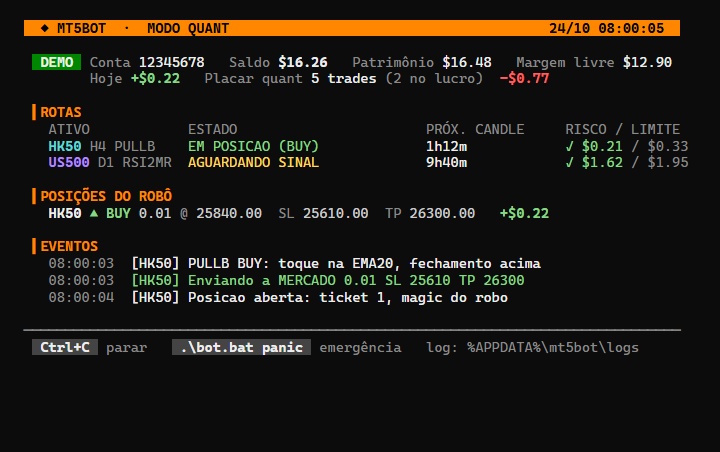
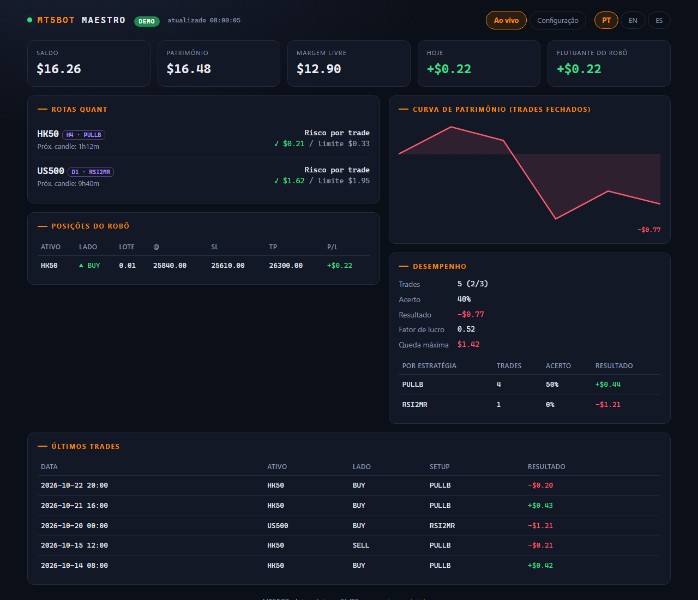
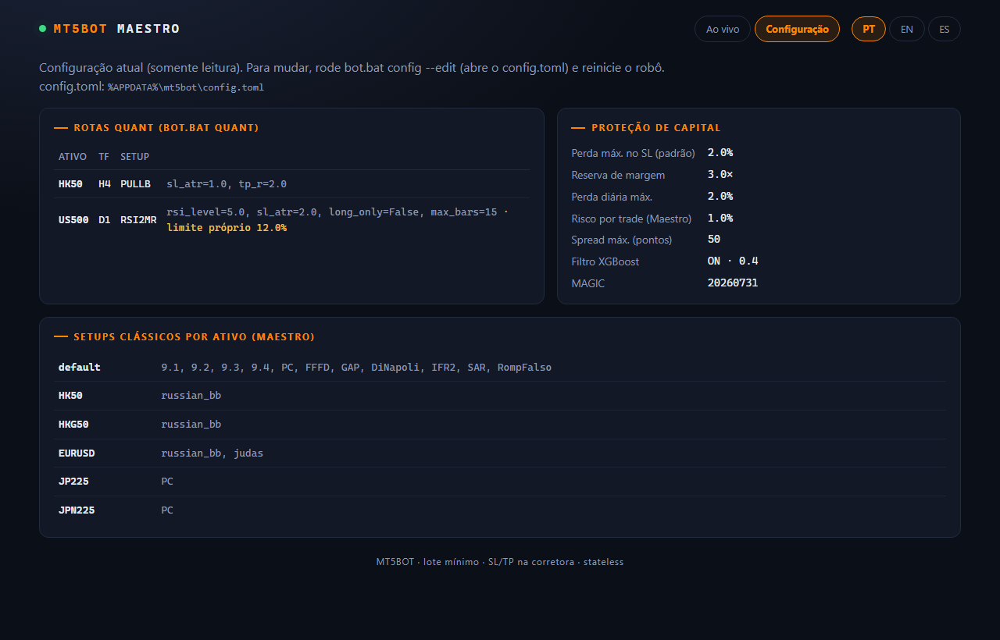

# 9. Dados, telemetria e interfaces

## 9.1 Pasta de dados do usuário

`mt5bot/core/paths.py` é a **fonte única** de caminhos. Antes da v2.13 havia 7 cálculos duplicados espalhados pelo código.

| Sistema | Pasta |
|---|---|
| Windows | `%APPDATA%\mt5bot` |
| macOS | `~/Library/Application Support/mt5bot` |
| Linux | `$XDG_DATA_HOME/mt5bot` (padrão `~/.local/share/mt5bot`) |
| Qualquer | `MT5BOT_DATA_DIR` sobrepõe; usada pelos testes e por instalações portáteis |

As convenções seguem as orientações de cada plataforma (*XDG Base Directory* no Linux). Dados do usuário **nunca** ficam na pasta do programa, que, instalada, não deve ser alterada (cap. 10).

| Arquivo | Conteúdo | Código |
|---|---|---|
| `trades.json` | Trades reais: entrada, saída e `pnl_money` = lucro real dos *deals* (profit + comissão + swap) | `data/tracker.py` |
| `virtual_trades.json`, `virtual_rejections.json` | Trades de simulação e sinais vetados | `data/paper_tracker.py` |
| `state.json` | Estado persistente | `data/persistence.py` |
| `calibrations.json` | Calibrações do supervisor adaptativo | `mentorship/` (cap. 7) |
| `logs/` | Logs do Maestro/Cérebro e do Modo Quant | `core/logger.py`, `tools/quant_runner.py` |
| `config.toml` | Configuração do usuário | `core/user_config.py` |

**Por que JSON e não um banco de dados?** O volume é minúsculo (dezenas a milhares de registros), há um escritor por vez e o formato é legível por humanos e por qualquer ferramenta. Um SQLite seria a evolução natural se houvesse concorrência de escrita ou consultas complexas [Kleppmann 2017].

## 9.2 Configuração em camadas

```
config.py (padrões versionados)  ──▶  config.toml do usuário (sobrepõe)  ──▶  valores efetivos
```

`user_config.apply` lê o TOML (`tomllib`, ou `tomli` no Python 3.10) e valida **tipo e faixa** de cada chave. Por exemplo, `max_risk_pct` precisa ser um número entre 0,1 e 50, e um booleano não é aceito como número (em Python, `True == 1`). Um valor inválido é **recusado com aviso** citando o arquivo e a chave, e o padrão é mantido: um erro de digitação nunca derruba o robô nem afrouxa uma trava em silêncio. A origem de cada valor fica em `CONFIG_SOURCES` e aparece no `bot.bat config` e no dashboard. `bot.bat config --edit` gera um modelo comentado; um teste garante que, descomentado, ele é válido e cobre todas as chaves.

**Por que TOML?** É legível, tem tipos explícitos (número, booleano, tabela), não tem as armadilhas de indentação do YAML e é o formato padrão do ecossistema Python (`pyproject.toml`, PEP 518).

## 9.3 Logs

Saída com `logging`, nunca `print` no caminho de produção (uma regra do `AGENTS.md`). Arquivos em `<dados>/logs`: `bot_AAAAMMDD.log` (rotação diária por nome) e `quant_runner.log`. O `bot.bat diagnose` conta linhas ERROR/CRITICAL das últimas 24 h, e o `bot.bat tail` mostra o log mais recente.

## 9.4 Telemetria

`mt5bot/core/telemetry.py` alimenta as três interfaces a partir de chamadas baratas ao MT5:

| Função | O que produz |
|---|---|
| `account_snapshot()` | Login, REAL/DEMO, saldo, patrimônio, margem livre |
| `bot_positions()` | Só posições com o *magic* do robô (as manuais ficam de fora) |
| `route_risk()` | Perda no SL com lote mínimo para um sinal agora × limite da rota |
| `server_now()` / `next_close_text()` | Relógio do servidor e contagem até o fechamento do candle |
| `trade_stats()` / `group_stats()` | Estatísticas em US$: acerto, fator de lucro, queda máxima, curva de patrimônio |

### Relógio do servidor

O MT5 informa horários no fuso do servidor da corretora, e o `tick.time` de um ativo fechado fica parado (no fim de semana, por exemplo). `server_now` estima o fuso a partir do **tick mais recente** entre os ativos das rotas e criptomoedas (que negociam 24/7), arredondado a 30 minutos:
$$\text{offset} = \text{round}\!\left(\frac{t_{\text{tick mais recente}} - t_{\text{local UTC}}}{1800}\right)\times 1800$$
Se o último tick de um ativo tem mais de 10 minutos em relação a esse relógio, o mercado é dado como **fechado**. Sem isso, a contagem até o próximo candle mostrava valores falsos no fim de semana.

### Queda máxima

Calculada sobre a curva de resultado acumulado: $DD = \max_t (\max_{s \le t} E_s - E_t)$, em US$.

## 9.5 Interfaces

| Interface | Tecnologia | Atualização | Para quem |
|---|---|---|---|
| Painel do Modo Quant | Console com cores ANSI de 256 cores | 5 s | Operação diária das rotas validadas |
| Maestro | TUI Go (Bubble Tea) | 1 s | Vários robôs, simulação, comandos (cap. 2) |
| Dashboard web | `http.server` da biblioteca padrão + HTML/JS | 5 s (*polling* de `/api/live`) | Visão geral, curva de patrimônio, histórico |

**Painel do Modo Quant** (`tools/quant_runner.py`): as 400 velas só são baixadas quando um candle fecha (`CandleCache`); entre fechamentos, cada ciclo reaproveita o cache. As cores ANSI são habilitadas no console do Windows com `os.system("")`, que ativa o processamento de sequências de terminal virtual. `--plain` mantém só o log, para redirecionamento.



*Figura 9.1: o painel do Modo Quant (`bot.bat quant`): conta e placar no topo, uma linha por rota com estado, tempo até o próximo candle e risco × limite, posições do robô e os últimos eventos. Dados de demonstração.*

**Dashboard web** (`interfaces/dashboard.py`): sem *frameworks*. O servidor responde HTML estático e um JSON em `/api/live`; o JavaScript da página busca o JSON a cada 5 s e redesenha. A curva de patrimônio é um SVG gerado no navegador, com linha de zero e preenchimento colorido pelo sinal do resultado [Tufte 2001]. Escuta só em `127.0.0.1`: nada sai do computador. Textos em pt/en/es por *cookie*. Todo texto vindo de dados passa por *escape* de HTML, e um teste injeta `` para garantir isso.



*Figura 9.2: página "Ao vivo" do dashboard (`bot.bat dashboard`): indicadores da conta, rotas quant com risco × limite, posições, curva de patrimônio dos trades fechados, desempenho por estratégia e últimos trades. Dados de demonstração.*



*Figura 9.3: página "Configuração": rotas quant e seus parâmetros, as travas de proteção de capital e os setups clássicos por ativo, lidos da configuração efetiva (padrões + `config.toml`).*

**Por que sem *framework* web?** Flask ou FastAPI acrescentariam dependências e superfície de ataque para três rotas de leitura. A biblioteca padrão basta e cabe no princípio 7 da constituição (leve).

## 9.6 Princípios de interface aplicados

- **Visibilidade do estado do sistema** [Nielsen 1994]: REAL/DEMO, risco × limite, "mercado fechado" e motivo de cada trava sempre visíveis.
- **Prevenção de erros:** confirmação explícita de conta real (cap. 6 §6.6); Esc não encerra o Maestro; ações destrutivas atrás de comandos explícitos.
- **Estados vazios que ensinam:** sem robôs, o Maestro mostra os comandos para começar; sem trades, o dashboard explica quando a curva aparece.
- **Dados honestos:** valores em US$ a partir do lucro real dos *deals*, e não em pips, que não somam entre ativos diferentes [Tufte 2001].

## 9.7 Referencial teórico

[Nielsen 1994] heurísticas de usabilidade; [Tufte 2001] exibição de informação quantitativa; [Kleppmann 2017] armazenamento e fontes da verdade.
